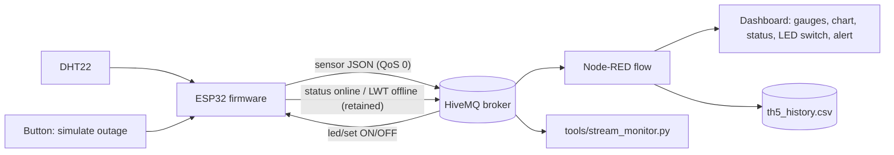

# TH5: Resilient ESP32 → MQTT → Node-RED pipeline

End-to-end IoT demo: an ESP32 reads a DHT22, publishes JSON over MQTT to a
public HiveMQ broker, and a Node-RED dashboard shows live data. The pipeline
survives network loss: the device detects it, keeps sampling into a buffer,
reconnects on its own and replays what it missed, with no loss and no
duplicates.

| Deliverable | Where |
|---|---|
| End-to-end demo (device → broker → dashboard) | `src/`, `node-red/flows.json`, `diagram.json` |
| Network-loss / auto-reconnect test | `docs/offline-test.md`, `tools/stream_monitor.py` |
| Demo images / video | `media/` (see `media/CAPTURE_CHECKLIST.md`) |
| Short report (extension: history + alerts) | `REPORT.md` |

## Architecture



## How resilience works

| Mechanism | Implementation |
|---|---|
| Failure detection | MQTT keep-alive 15 s; `mqtt.connected()` checked every loop |
| Offline signal | Retained **Last Will** on `…/status` (`offline`); `online` is published on every (re)connect |
| Reconnect | Non-blocking, exponential backoff 1 s → 30 s plus random jitter; 3 s socket timeout so the loop never stalls |
| No data loss | Samples taken while offline go into a 120-slot ring buffer (oldest dropped when full) and are replayed in order, paced at 150 ms |
| No duplicates | Each sample carries `boot` (random per boot) and `seq`; Node-RED drops repeated `(boot, seq)` pairs |
| Order preserved | New samples are queued behind any backlog instead of overtaking it |

### MQTT topics (`TOPIC_ROOT = tnkh/th5/esp32`)

| Topic | Direction | Payload |
|---|---|---|
| `…/sensor` | device → broker | `{"boot":123,"seq":42,"ts":1760000000,"t":26.5,"h":60.0,"replayed":false}` |
| `…/status` | device → broker, retained | `online` / `offline` (Last Will) |
| `…/info` | device → broker, retained | `{"fw":"1.0.0","boot":123,"ip":"…","reconnects":0}` |
| `…/led/set` | broker → device | `ON` / `OFF` |
| `…/led/state` | device → broker, retained | `ON` / `OFF` |

`ts` is Unix time in seconds (0 until NTP is synced). `replayed` is `true` for
samples that were buffered during an outage.

> **Important:** `broker.hivemq.com` is public and shared. Change
> `TOPIC_ROOT` in `src/config.h` to something unique (for example add your
> student ID) and use the same value in the Node-RED topics and in
> `tools/stream_monitor.py --root`. Otherwise you will see other people's data.

## Hardware / wiring (also in `diagram.json`)

| Part | ESP32 pin |
|---|---|
| DHT22 data | GPIO 4 (VCC → 3V3, GND → GND) |
| LED | GPIO 2 → 330 Ω → LED → GND |
| Push button | GPIO 15 → GND (internal pull-up) |

## Quick start

### 1. Firmware (PlatformIO + Wokwi)

```bash
pio run                       # build
```
Then in VS Code open `diagram.json` and press **Start Simulation** (Wokwi
extension). On Windows, if `pio` is not recognised in PowerShell use the full
path: `C:\Users\<you>\.platformio\penv\Scripts\pio.exe run`.

`diagram.json` places the parts approximately; if Wokwi shows a wire in the
wrong spot, just drag it. The pin names are what matter.

For a real board, change `WIFI_SSID` / `WIFI_PASS` in `src/config.h`, wire as
above and run `pio run -t upload`.

### 2. Node-RED dashboard

```bash
npm install -g node-red
cd ~/.node-red && npm install node-red-dashboard
node-red
```
Open <http://localhost:1880>, menu → **Import** → `node-red/flows.json` →
**Deploy**. Dashboard: <http://localhost:1880/ui>.

The flow also appends every sample to `th5_history.csv` (in Node-RED's working
directory) with columns `iso_time,temperature_c,humidity_pct,replayed`, and
shows a warning when a live sample exceeds 35 °C (change the inject node
"Set threshold" to alter it).

### 3. Test network loss

Follow `docs/offline-test.md`. In short: press the button (or send `o` in the
Serial Monitor) to cut the network, wait, press again, and run
`python tools/stream_monitor.py` to prove there are no gaps or duplicates.

Serial commands: `o` toggle simulated outage, `s` print status.

## HTTP API (on the device, port 80)

| Endpoint | Description |
|---|---|
| `GET /api/sensor` | Latest reading, MQTT state, queue length (503 until the first sample) |
| `GET /api/status` | Uptime, Wi-Fi/MQTT state, buffer stats, reconnect count, errors |

Wokwi Free has no private gateway, so these endpoints are only reachable from
a real board on your LAN. The MQTT path works in both.

## Tests

```bash
g++ -std=c++17 -Wall -Wextra -I src test/native/ring_buffer_test.cpp -o /tmp/rb && /tmp/rb
cd tools && python -m unittest -v test_stream_monitor
```
GitHub Actions (`.github/workflows/build.yml`) builds the firmware and runs
both on every push.

## Known limitations

- `PubSubClient` publishes at QoS 0, so a message in flight at the instant of
  an abrupt loss can be lost; the verifier reports this as `missing`.
- The buffer is in RAM: a reset during an outage loses the queued samples.
- The public broker offers no authentication or encryption. For anything
  beyond a lab demo use a private broker with TLS (see `REPORT.md`).
- The dashboard chart plots replayed points at their arrival time on versions
  of `node-red-dashboard` that ignore `msg.timestamp`; the CSV always has the
  original time.

## Project layout

```
.
├── src/                 firmware (main.cpp, config.h, ring_buffer.h)
├── test/native/         host-side unit test
├── node-red/flows.json  dashboard flow (import into Node-RED)
├── tools/               stream_monitor.py + tests
├── docs/offline-test.md test procedure and results table
├── media/               screenshots / video (checklist inside)
├── diagram.json         Wokwi circuit
├── wokwi.toml           Wokwi firmware paths
├── platformio.ini
└── REPORT.md            150-250 word report (Vietnamese)
```

## License

MIT, see `LICENSE`.
